# Piano cartesiano e retta

## 1. Punti e segmenti

### 1.1 Punti nel piano cartesiano

Fissiamo in un piano un **sistema di riferimento cartesiano ortogonale**, detto anche **piano cartesiano**, considerando due rette orientate tra loro perpendicolari. Le due rette sono gli **assi** del riferimento e vengono chiamate **asse delle ascisse** (o asse $x$) e **asse delle ordinate** (o asse $y$). Il loro punto di intersezione $O$ è l'**origine**.

Scelta un'unità di misura su entrambi gli assi, ogni punto $P$ del piano è rappresentato da una coppia ordinata di numeri reali $(x_P; y_P)$ e viceversa. Si crea così una **corrispondenza biunivoca** tra i punti del piano e le coppie ordinate di numeri reali.

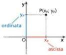

In ogni coppia $(x_P; y_P)$, $x_P$ e $y_P$ sono le **coordinate** del punto: il primo numero è l'**ascissa**, il secondo è l'**ordinata**.

Chiamiamo **quadranti** i punti interni ai quattro angoli retti in cui il piano cartesiano è diviso dagli assi. I quadranti sono ordinati in senso antiorario a partire da quello in alto a destra. Le coordinate dei punti sono positive o negative a seconda del quadrante in cui i punti si trovano.

I punti dell'asse $x$ hanno ordinata $0$, quelli dell'asse $y$ hanno ascissa $0$. L'origine ha coordinate $O(0; 0)$.

Per esempio, il punto $A(-4; 3)$ appartiene al secondo quadrante, mentre $B(0; -5)$ appartiene all'asse $y$.

### 1.2 Distanza fra due punti

#### Punti con la stessa ordinata o la stessa ascissa

La distanza fra due punti $A(x_A; y_A)$ e $B(x_B; y_B)$ che hanno la stessa ordinata ($y_A = y_B$) è la differenza delle loro ascisse, presa in valore assoluto (così non dobbiamo preoccuparci di quale sia la maggiore):

$$\overline{AB} = |x_B - x_A|.$$

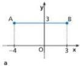

Per esempio, nella figura a: $\overline{AB} = |x_B - x_A| = |3 - (-4)| = 7$.

Analogamente, la distanza fra due punti $A(x_A; y_A)$ e $B(x_B; y_B)$ con la stessa ascissa ($x_A = x_B$) è:

$$\overline{AB} = |y_B - y_A|.$$

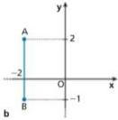

Per esempio, nella figura b: $\overline{AB} = |-1 - 2| = 3$.

#### Caso generale

Consideriamo il segmento $AB$ non parallelo agli assi e indichiamo con $H$ il punto di intersezione tra la retta parallela all'asse $x$ passante per $A$ e la retta parallela all'asse $y$ passante per $B$. Il punto $H$ ha ascissa $x_B$ e ordinata $y_A$.

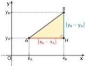

Applichiamo il teorema di Pitagora al triangolo rettangolo $ABH$:

$$\overline{AB} = \sqrt{\overline{AH}^2 + \overline{BH}^2}, \qquad \text{con} \quad \overline{AH} = |x_B - x_A| \quad \text{e} \quad \overline{BH} = |y_B - y_A|,$$

quindi:

$$\boxed{\overline{AB} = \sqrt{(x_B - x_A)^2 + (y_B - y_A)^2}}$$

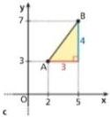

Per esempio, nella figura c:

$$\overline{AB} = \sqrt{(5 - 2)^2 + (7 - 3)^2} = \sqrt{3^2 + 4^2} = \sqrt{9 + 16} = 5.$$

La formula vale anche nei due casi particolari precedenti. Inoltre, la distanza di un punto $P(x; y)$ dall'origine è

$$\overline{OP} = \sqrt{x^2 + y^2}.$$

### 1.3 Punto medio di un segmento

Consideriamo i punti $A(x_A; y_A)$ e $B(x_B; y_B)$. Vogliamo calcolare le coordinate del punto medio $M$ del segmento $AB$.

Tracciamo le parallele agli assi passanti per $A$, $B$ e $M$ e applichiamo il **teorema di Talete dei segmenti congruenti**: dato un fascio di rette parallele tagliato da due trasversali, a segmenti congruenti su una trasversale corrispondono segmenti congruenti sull'altra.

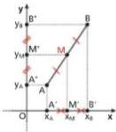

Poiché per ipotesi $M$ è il punto medio di $AB$, si ha $AM \cong MB$, quindi $A'M' \cong M'B'$ e $A''M'' \cong M''B''$. Allora:

$$\overline{A'M'} = \overline{M'B'} \quad \Rightarrow \quad |x_M - x_A| = |x_B - x_M|.$$

Poiché $x_A < x_M < x_B$, possiamo eliminare i valori assoluti:

$$x_M - x_A = x_B - x_M \;\Rightarrow\; 2x_M = x_A + x_B \;\Rightarrow\; x_M = \frac{x_A + x_B}{2}.$$

Con considerazioni analoghe si ottiene $y_M = \dfrac{y_A + y_B}{2}$.

In sintesi, dati i punti $A(x_A; y_A)$ e $B(x_B; y_B)$, il punto medio $M$ del segmento $AB$ ha coordinate:

$$\boxed{x_M = \frac{x_A + x_B}{2}, \qquad y_M = \frac{y_A + y_B}{2}}$$

> **Esempio.** Determiniamo il punto medio $M$ del segmento $AB$ con $A(2; 1)$ e $B(8; 5)$.
>
> $$x_M = \frac{2 + 8}{2} = 5, \qquad y_M = \frac{1 + 5}{2} = 3 \quad \Rightarrow \quad M(5; 3).$$
>
> 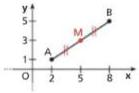

### 1.4 Baricentro di un triangolo

Il **baricentro** di un triangolo è il punto di incontro delle tre mediane. Ognuna di esse è divisa dal baricentro in due parti tali che quella che ha un estremo nel vertice è doppia dell'altra.

Consideriamo i punti non allineati $A(x_A; y_A)$, $B(x_B; y_B)$ e $C(x_C; y_C)$. Vogliamo calcolare le coordinate $(x_G; y_G)$ del baricentro $G$ del triangolo $ABC$.

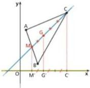

Le coordinate di $M$, punto medio del lato $AB$, sono:

$$x_M = \frac{x_A + x_B}{2}, \qquad y_M = \frac{y_A + y_B}{2}.$$

Per la proprietà del baricentro vale $CG \cong 2\,GM$. Tracciamo le parallele all'asse $y$ passanti per $M$, $G$ e $C$ e, considerando le trasversali $MC$ e $M'C'$, applichiamo il teorema di Talete (in un fascio di rette parallele tagliate da due trasversali, i segmenti su una trasversale sono proporzionali ai segmenti corrispondenti sull'altra). Poiché $CG \cong 2\,GM$, allora $C'G' \cong 2\,G'M'$.

Le misure dei segmenti $C'G'$ e $G'M'$ sono:

$$\overline{C'G'} = x_C - x_G, \qquad \overline{G'M'} = x_G - x_M.$$

Da $\overline{C'G'} = 2\,\overline{G'M'}$ otteniamo:

$$x_C - x_G = 2(x_G - x_M) \;\Rightarrow\; 3x_G = x_C + 2x_M \;\Rightarrow\; x_G = \frac{x_C + 2x_M}{3}.$$

Sostituendo $x_M = \dfrac{x_A + x_B}{2}$:

$$x_G = \frac{x_C + 2 \cdot \frac{x_A + x_B}{2}}{3} = \frac{x_A + x_B + x_C}{3}.$$

Analogamente, proiettando $M$, $G$ e $C$ sull'asse $y$, si trova $y_G = \dfrac{y_A + y_B + y_C}{3}$.

Quindi, dato un triangolo di vertici $A(x_A; y_A)$, $B(x_B; y_B)$, $C(x_C; y_C)$, le coordinate del baricentro $G$ sono:

$$\boxed{x_G = \frac{x_A + x_B + x_C}{3}, \qquad y_G = \frac{y_A + y_B + y_C}{3}}$$

> **Esempio.** Troviamo il baricentro del triangolo di vertici $A(0; -1)$, $B(6; 2)$ e $C(3; 5)$.
>
> $$x_G = \frac{0 + 6 + 3}{3} = 3, \qquad y_G = \frac{-1 + 2 + 5}{3} = 2 \quad \Rightarrow \quad G(3; 2).$$
>
> 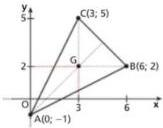

## 2. Rette nel piano cartesiano

### 2.1 Equazione lineare in due variabili

Un'**equazione lineare in due variabili** $x$ e $y$ è un'equazione di primo grado rispetto a entrambe le incognite. Può essere scritta nella forma

$$ax + by + c = 0, \qquad \text{con } a, b, c \in \mathbb{R} \text{ e } a, b \text{ non entrambi nulli}.$$

Una **soluzione** dell'equazione è una coppia $(x_0; y_0)$ di numeri reali che la soddisfa, cioè che rende vera l'uguaglianza.

> **Esempio.** Data l'equazione $3x + 2y - 6 = 0$, sostituiamo dei valori a $x$:
>
> $$\begin{aligned} x = 0 &\;\Rightarrow\; 3 \cdot 0 + 2y - 6 = 0 \;\Rightarrow\; 2y = 6 \;\Rightarrow\; y = 3; \\ x = 1 &\;\Rightarrow\; 3 \cdot 1 + 2y - 6 = 0 \;\Rightarrow\; 2y = 3 \;\Rightarrow\; y = \tfrac{3}{2}. \end{aligned}$$
>
> Le coppie $(0; 3)$ e $\left(1; \tfrac{3}{2}\right)$ sono due soluzioni dell'equazione.

Le soluzioni sono infinite; se $a \neq 0$ e $b \neq 0$, per ottenerle basta sostituire a $x$ un qualsiasi numero reale e determinare il corrispondente valore di $y$.

### 2.2 Equazione della retta in forma implicita

Data un'equazione lineare in due variabili, a ogni soluzione corrisponde un punto del piano cartesiano; invece, dato un punto del piano, non sempre le sue coordinate sono una delle infinite soluzioni dell'equazione. Si può dimostrare la seguente proprietà.

> **Proprietà.** A ogni retta del piano cartesiano corrisponde un'equazione lineare in due variabili e, viceversa, a ogni equazione lineare in due variabili corrisponde una retta.

L'equazione

$$\boxed{ax + by + c = 0}$$

con $a, b, c \in \mathbb{R}$ e $a, b$ non entrambi nulli, rappresenta, al variare di $a$, $b$ e $c$, tutte le rette del piano. È detta **equazione della retta in forma implicita**, perché nessuna delle due variabili è ricavata in funzione dell'altra.

#### Casi particolari dell'equazione $ax + by + c = 0$

Vediamo che cosa accade se uno o due dei parametri $a$, $b$, $c$ si annullano (con $a$ e $b$ non entrambi nulli).

**1. Retta parallela all'asse $x$.** Se $a = 0$ e $b \neq 0$, l'equazione diventa

$$by + c = 0 \;\Rightarrow\; y = -\frac{c}{b}.$$

Ponendo $k = -\dfrac{c}{b}$ otteniamo $y = k$. Detto $A(0; k)$ il punto di intersezione con l'asse $y$ di una retta parallela all'asse $x$:

- tutti i punti della retta hanno ordinata $k$;
- ogni punto di ordinata $k$ appartiene alla retta.

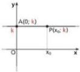

Quindi tutti e soli i punti della retta soddisfano l'equazione

$$y = k \qquad \text{(retta parallela all'asse } x\text{)}.$$

Per esempio, $y = -2$ è la retta parallela all'asse $x$ i cui punti hanno tutti ordinata $-2$. Se $k = 0$ (cioè $c = 0$), la retta coincide con l'asse $x$:

$$y = 0 \qquad \text{(equazione dell'asse } x\text{)}.$$

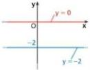

**2. Retta parallela all'asse $y$.** Se $a \neq 0$ e $b = 0$, l'equazione diventa

$$ax + c = 0 \;\Rightarrow\; x = -\frac{c}{a}.$$

Ponendo $h = -\dfrac{c}{a}$ otteniamo $x = h$. Detto $B(h; 0)$ il punto di intersezione con l'asse $x$ di una retta parallela all'asse $y$:

- tutti i punti della retta hanno ascissa $h$;
- ogni punto di ascissa $h$ appartiene alla retta.

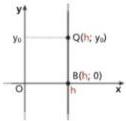

Quindi tutti e soli i punti della retta soddisfano l'equazione

$$x = h \qquad \text{(retta parallela all'asse } y\text{)}.$$

Per esempio, $x = \frac{1}{2}$ è la retta parallela all'asse $y$ i cui punti hanno tutti ascissa $\frac{1}{2}$. Se $h = 0$ (cioè $c = 0$), la retta coincide con l'asse $y$:

$$x = 0 \qquad \text{(equazione dell'asse } y\text{)}.$$

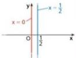

**3. Retta passante per l'origine.** Se $a \neq 0$, $b \neq 0$ e $c = 0$, l'equazione diventa $ax + by = 0$ e rappresenta una retta passante per l'origine. Infatti, sostituendo le coordinate di $O(0; 0)$ si ottiene $a \cdot 0 + b \cdot 0 = 0$, cioè $0 = 0$: l'equazione è soddisfatta per qualunque valore di $a$ e $b$.

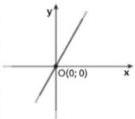

### 2.3 Equazione della retta in forma esplicita

Se nell'equazione $ax + by + c = 0$ esplicitiamo la variabile $y$ (supponendo $b \neq 0$), otteniamo:

$$by = -ax - c \;\xrightarrow{\;b \neq 0\;}\; y = -\frac{a}{b}x - \frac{c}{b}.$$

Con la condizione $b \neq 0$ escludiamo il caso $ax + c = 0$, che rappresenta una retta parallela all'asse $y$.

Ponendo $m = -\dfrac{a}{b}$ e $q = -\dfrac{c}{b}$ si ottiene

$$\boxed{y = mx + q}$$

che è l'equazione di una generica retta non parallela all'asse $y$. È detta **equazione della retta in forma esplicita**, perché la variabile $y$ è espressa in funzione di $x$; $y = mx + q$ è l'equazione di una **funzione lineare**.

#### Casi particolari dell'equazione $y = mx + q$

**1. Retta parallela all'asse $x$.** Se $m = 0$, l'equazione diventa $y = q$, che rappresenta una retta parallela all'asse $x$. Se anche $q = 0$, otteniamo $y = 0$, l'equazione dell'asse $x$.

**2. Retta passante per l'origine.** Se $q = 0$, l'equazione diventa

$$y = mx,$$

che rappresenta una retta passante per l'origine. Infatti, sostituendo le coordinate di $O(0; 0)$, per ogni $m \in \mathbb{R}$ si ha $0 = m \cdot 0$, cioè $0 = 0$.

Per esempio, rappresentiamo $y = 2x$ assegnando a $x$ alcuni valori:

| $x$ | $y$ |
|:---:|:---:|
| $-1$ | $-2$ |
| $0$ | $0$ |
| $\frac{1}{2}$ | $1$ |
| $1$ | $2$ |

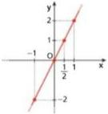

Viceversa, data una retta passante per l'origine e diversa dall'asse $y$, prendiamo alcuni suoi punti, per esempio $P$, $P'$ e $P''$, e indichiamo con $H$, $H'$ e $H''$ le loro proiezioni sull'asse $x$. I triangoli $OPH$, $OP'H'$ e $OP''H''$ sono simili, quindi:

$$\frac{\overline{PH}}{\overline{OH}} = \frac{\overline{P'H'}}{\overline{OH'}} = \frac{\overline{P''H''}}{\overline{OH''}}.$$

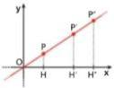

In termini di coordinate:

$$\frac{y_P}{x_P} = \frac{y_{P'}}{x_{P'}} = \frac{y_{P''}}{x_{P''}} = m,$$

dove $m$ è una costante reale. Tutti i punti della retta godono di questa proprietà e, viceversa, si può dimostrare che la proprietà vale soltanto per essi. In conclusione, una retta passante per l'origine, escluso l'asse $y$, ha equazione $y = mx$, e viceversa.

- Se $m = 1$, i punti della retta hanno ascissa uguale all'ordinata. Il triangolo $OHP$ è rettangolo e isoscele, quindi $H\widehat{O}P$ è metà dell'angolo retto e la retta è la **bisettrice del primo e terzo quadrante**:
  $$y = x.$$

  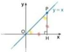

- Se $m = -1$, i punti della retta hanno coordinate opposte. Il triangolo $OKQ$ è rettangolo e isoscele e l'angolo $K\widehat{O}Q$ è metà dell'angolo retto: la retta è la **bisettrice del secondo e quarto quadrante**:
  $$y = -x.$$

  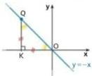

- Se $m = 0$, si ritrova l'equazione dell'asse $x$.

#### Confronto tra forma implicita ed esplicita

Le uniche rette non rappresentate dall'equazione $y = mx + q$, al variare di $m$ e $q$, sono le rette parallele all'asse $y$, di equazione $x = h$. Quindi:

$$ax + by + c = 0 \quad \Longleftrightarrow \quad y = mx + q \;\;\lor\;\; x = h.$$

Se $b \neq 0$, per passare dalla forma implicita a quella esplicita basta risolvere l'equazione rispetto a $y$. Questo è utile per mettere in evidenza i valori di $m$ e $q$, che hanno un preciso significato nel grafico della retta.

### 2.4 Significato di $m$ e $q$ nell'equazione $y = mx + q$

#### Coefficiente angolare e pendenza

Chiamiamo **angolo fra retta e asse $x$** l'angolo orientato $\alpha$ che ha per vertice il loro punto di intersezione e per lati la semiretta formata dai punti della retta con ordinata positiva e il semiasse positivo delle $x$. L'angolo è misurato in senso antiorario a partire dal semiasse positivo delle ascisse.

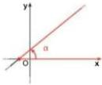

Il valore di $m$ è funzione di tale angolo ed esprime la **pendenza** della retta rispetto all'asse $x$. Per questo motivo il coefficiente $m$ si chiama **coefficiente angolare**.

> **Esempio.** Ricordando le relazioni fra i lati di un triangolo rettangolo con angoli acuti di $30^\circ$ e $60^\circ$: se $\overline{OA} = 1$, allora $\overline{OP} = 2$ e $\overline{AP} = \sqrt{3}$. Quindi, se l'angolo fra la retta passante per l'origine e l'asse $x$ è di $60^\circ$, il punto $P(1; \sqrt{3})$ appartiene alla retta e:
>
> $$\sqrt{3} = m \cdot 1 \;\Rightarrow\; m = \sqrt{3}.$$
>
> 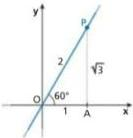

Vediamo come varia $m$ al variare dell'angolo $\alpha$:

- se $\alpha$ è nullo o piatto, $m$ è nullo;
- se $\alpha$ è acuto, $m$ è positivo e assume valori sempre maggiori man mano che l'angolo si avvicina all'angolo retto;
- se $\alpha$ è retto, non esiste un corrispondente valore di $m$, perché le rette parallele all'asse $y$ non hanno equazione esprimibile nella forma $y = mx + q$;
- se $\alpha$ è ottuso, $m$ è negativo e assume valori sempre minori (cioè sempre maggiori in valore assoluto) man mano che $\alpha$ si avvicina all'angolo retto.

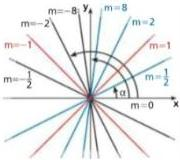

> **Esempio.** Per normativa, una rampa per disabili non può avere una pendenza superiore all'$8\%$: per una rampa con la massima pendenza consentita, a uno spostamento orizzontale di $1\ \text{m} = 100\ \text{cm}$ corrisponde uno spostamento verticale di $8\ \text{cm}$. A quale coefficiente angolare corrisponde tale pendenza?
>
> Rappresentiamo il profilo della rampa con una retta passante per l'origine e per il punto $P(100; 8)$. La coppia $(100; 8)$ deve essere soluzione dell'equazione $y = mx$:
>
> $$8 = m \cdot 100 \;\Rightarrow\; m = \frac{8}{100} = \frac{2}{25} = 8\%,$$
>
> che è proprio la pendenza della rampa.
>
> 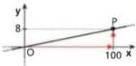

#### Ordinata all'origine e intersezione con l'asse $y$

Il valore di $q$ rappresenta l'ordinata del punto di intersezione $(0; q)$ della retta con l'asse $y$. Per questo motivo il termine noto dell'equazione $y = mx + q$ si chiama **ordinata all'origine** (o **intercetta**). Se $q = 0$, la retta passa per l'origine.

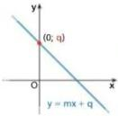

## 3. Posizione reciproca di due rette

Due rette $r$ e $s$ possono essere **incidenti**, **parallele e distinte** oppure **parallele e coincidenti**. La loro posizione reciproca è collegata al sistema formato dalle due equazioni:

$$\begin{cases} ax + by + c = 0 \\ a'x + b'y + c' = 0 \end{cases}$$

### 3.1 Rette incidenti

Due rette incidenti hanno un solo punto in comune, le cui coordinate sono la soluzione del sistema formato dalle loro equazioni.

> **Esempio.** Un'azienda ha due linee di produzione per fabbricare viti. Ogni linea ha un costo fisso di avviamento e un costo variabile che dipende dal numero di confezioni prodotte:
>
> - linea A: $5$ € per l'avvio $+\;2{,}50$ € a confezione;
> - linea B: $10$ € per l'avvio $+\;2$ € a confezione.
>
> A ogni avvio si producono al massimo $9$ confezioni di un primo tipo di viti, mentre di un secondo tipo se ne producono sempre più di $12$. Quale linea conviene usare per ciascun tipo?
>
> Indichiamo con $x$ il numero di confezioni prodotte e con $y$ il costo totale ($x > 0$, $y > 0$), supponendo che possano assumere tutti i valori reali positivi:
>
> $$\text{linea A: } y = \underbrace{5}_{\text{avvio}} + \underbrace{2{,}50\,x}_{\text{confezioni}}, \qquad \text{linea B: } y = \underbrace{10}_{\text{avvio}} + \underbrace{2x}_{\text{confezioni}}.$$
>
> Rappresentiamo le rette e troviamo il punto di intersezione:
>
> $$\begin{cases} y = 5 + 2{,}50\,x \\ y = 10 + 2x \end{cases} \;\Rightarrow\; \begin{cases} 10 + 2x = 5 + 2{,}50\,x \\ y = 10 + 2x \end{cases} \;\Rightarrow\; \begin{cases} 0{,}50\,x = 5 \\ y = 10 + 2x \end{cases} \;\Rightarrow\; \begin{cases} x = 10 \\ y = 30 \end{cases}$$
>
> 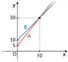
>
> Conviene la linea che, al variare di $x$, comporta costi più bassi. Per $x = 10$ le due linee sono equivalenti, per $x < 10$ conviene la A, per $x > 10$ conviene la B. Quindi per il primo tipo di viti (al massimo $9$ confezioni) conviene la linea A, per il secondo (più di $12$ confezioni) la linea B.

### 3.2 Rette parallele

> **Teorema (rette parallele).** Due rette $r$ e $s$, non parallele all'asse $y$, di equazioni $y = mx + q$ e $y = m_1x + q_1$, sono parallele se e solo se hanno lo stesso coefficiente angolare:
>
> $$r \parallel s \quad \Longleftrightarrow \quad m = m_1.$$

**Dimostrazione.** Due rette sono parallele se non hanno punti in comune oppure se coincidono. Il sistema

$$\begin{cases} y = mx + q \\ y = m_1x + q_1 \end{cases}$$

non può quindi essere determinato (altrimenti le rette sarebbero incidenti): deve essere impossibile o indeterminato. Con il metodo del confronto otteniamo

$$mx + q = m_1x + q_1 \;\Rightarrow\; (m - m_1)\,x = q_1 - q,$$

che è impossibile o indeterminata se e solo se $m - m_1 = 0$, cioè $m = m_1$. $\blacksquare$

> **Esempio.** Le rette $y = 2x + 4$ e $y = 2x - 1$ sono parallele perché hanno lo stesso coefficiente angolare $2$.
>
> 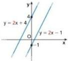

Se le rette $r$ e $s$, non parallele all'asse $y$, hanno equazioni in forma implicita

$$r: ax + by + c = 0, \qquad s: a_1x + b_1y + c_1 = 0,$$

i loro coefficienti angolari sono $m = -\dfrac{a}{b}$ e $m_1 = -\dfrac{a_1}{b_1}$. Quindi:

$$m = m_1 \;\Longleftrightarrow\; -\frac{a}{b} = -\frac{a_1}{b_1} \;\Longleftrightarrow\; ab_1 = a_1b \;\Longleftrightarrow\; ab_1 - a_1b = 0.$$

In sintesi:

$$\boxed{r \parallel s \;\Longleftrightarrow\; m = m_1 \;\Longleftrightarrow\; ab_1 - a_1b = 0}$$

La condizione di parallelismo $ab_1 - a_1b = 0$ vale anche per rette parallele all'asse $y$. Per esempio:

$$r: x - 4 = 0, \quad s: 5x + 10 = 0; \qquad 1 \cdot 0 - 5 \cdot 0 = 0 \;\Rightarrow\; r \parallel s.$$

Inoltre le rette sono:

- **parallele e distinte** se $m = m_1$ e $q \neq q_1$;
- **parallele e coincidenti** se $m = m_1$ e $q = q_1$.

### 3.3 Riepilogo dei casi possibili

| Posizione | Condizione | Sistema |
|---|---|---|
| Incidenti | $\dfrac{a}{a_1} \neq \dfrac{b}{b_1} \;\Longleftrightarrow\; m \neq m_1$ | determinato (la soluzione è il punto $P$ di intersezione) |
| Parallele e distinte | $\dfrac{a}{a_1} = \dfrac{b}{b_1} \neq \dfrac{c}{c_1} \;\Longleftrightarrow\; m = m_1 \,\land\, q \neq q_1$ | impossibile |
| Coincidenti | $\dfrac{a}{a_1} = \dfrac{b}{b_1} = \dfrac{c}{c_1} \;\Longleftrightarrow\; m = m_1 \,\land\, q = q_1$ | indeterminato |

| a. Incidenti | b. Parallele e distinte | c. Coincidenti |
|:---:|:---:|:---:|
| 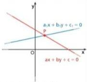 | 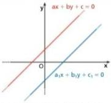 | 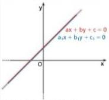 |

### 3.4 Rette perpendicolari

> **Teorema (rette perpendicolari).** Due rette $r$ e $s$, non parallele agli assi, di equazioni $y = mx + q$ e $y = m_1x + q_1$, sono perpendicolari se e solo se il prodotto dei loro coefficienti angolari è $-1$:
>
> $$r \perp s \quad \Longleftrightarrow \quad m \cdot m_1 = -1.$$

**Dimostrazione.**

1. Consideriamo le rette $r'$ e $s'$, parallele a $r$ e $s$ e passanti per l'origine:
   $$r': y = mx, \qquad s': y = m_1x.$$
   Gli angoli formati da $r'$ e $s'$ sono congruenti a quelli formati da $r$ e $s$, quindi $r' \perp s'$ se e solo se $r \perp s$. Basta allora dimostrare il teorema per $r'$ e $s'$.

   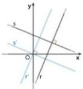

2. Su $r'$ e $s'$ prendiamo i punti di ascissa $1$: $A(1; m)$ e $B(1; m_1)$. Il triangolo $AOB$ è rettangolo in $O$ se e solo se vale il teorema di Pitagora:
   $$\overline{AB}^2 = \overline{OA}^2 + \overline{OB}^2.$$

   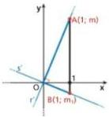

3. Esprimiamo i tre quadrati in funzione di $m$ e $m_1$:
   $$\overline{AB} = |m - m_1| \;\Rightarrow\; \overline{AB}^2 = (m - m_1)^2,$$
   $$\overline{OA} = \sqrt{(1 - 0)^2 + (m - 0)^2} \;\Rightarrow\; \overline{OA}^2 = 1 + m^2,$$
   $$\overline{OB} = \sqrt{(1 - 0)^2 + (m_1 - 0)^2} \;\Rightarrow\; \overline{OB}^2 = 1 + m_1^2.$$

4. Sostituendo nell'uguaglianza del teorema di Pitagora:
   $$(m - m_1)^2 = (1 + m^2) + (1 + m_1^2) \;\Rightarrow\; m^2 + m_1^2 - 2mm_1 = 2 + m^2 + m_1^2 \;\Rightarrow\; m \cdot m_1 = -1. \qquad \blacksquare$$

> **Esempio.** Le rette $y = 2x + 2$ e $y = -\frac{1}{2}x + 1$ sono perpendicolari perché il prodotto dei loro coefficienti angolari è $-1$:
>
> $$2 \cdot \left(-\frac{1}{2}\right) = -1.$$
>
> 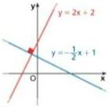

Se le rette hanno equazioni in forma implicita $r: ax + by + c = 0$ e $s: a_1x + b_1y + c_1 = 0$, allora sono perpendicolari se e solo se:

$$m = -\frac{1}{m_1} \;\Longleftrightarrow\; -\frac{a}{b} = -\frac{1}{-\frac{a_1}{b_1}} \;\Longleftrightarrow\; -\frac{a}{b} = \frac{b_1}{a_1} \;\Longleftrightarrow\; aa_1 + bb_1 = 0.$$

In sintesi:

$$\boxed{r \perp s \;\Longleftrightarrow\; m = -\frac{1}{m_1} \;\Longleftrightarrow\; aa_1 + bb_1 = 0}$$

La condizione di perpendicolarità $aa_1 + bb_1 = 0$ vale anche per rette parallele agli assi. Per esempio:

$$r: y - 4 = 0, \quad s: 2x + 5 = 0; \qquad 0 \cdot 2 + 1 \cdot 0 = 0 \;\Rightarrow\; r \perp s.$$

## 4. Determinare l'equazione di una retta

Vogliamo trovare l'equazione di una retta quando ne conosciamo un punto e il coefficiente angolare, oppure due punti. Poiché il coefficiente angolare contiene l'informazione sulla direzione della retta, dalla geometria euclidea sappiamo che ciascuna delle due condizioni individua univocamente la retta.

### 4.1 Retta passante per un punto e di coefficiente angolare noto

Se una retta non parallela all'asse $y$ passa per il punto $P(x_1; y_1)$, le coordinate di $P$ devono soddisfare l'equazione $y = mx + q$, cioè deve valere

$$y_1 = mx_1 + q.$$

Sottraendo membro a membro questa uguaglianza da $y = mx + q$ otteniamo l'**equazione della retta di coefficiente angolare $m$ passante per $P(x_1; y_1)$**:

$$\boxed{y - y_1 = m\,(x - x_1)}$$

> **Esempio.** L'equazione della retta di coefficiente angolare $\frac{3}{4}$ passante per $P(1; 2)$ è:
>
> $$y - 2 = \frac{3}{4}(x - 1) \;\Rightarrow\; y = \frac{3}{4}x + \frac{5}{4}.$$

### 4.2 Coefficiente angolare, note le coordinate di due punti

Ricaviamo il coefficiente angolare $m$ di una retta $y = mx + q$ in funzione delle coordinate di due suoi punti distinti $A(x_1; y_1)$ e $B(x_2; y_2)$. Poiché $A$ e $B$ appartengono alla retta:

$$y_1 = mx_1 + q, \qquad y_2 = mx_2 + q.$$

Sottraendo membro a membro la prima dalla seconda:

$$y_2 - y_1 = m(x_2 - x_1) \;\Rightarrow\; m = \frac{y_2 - y_1}{x_2 - x_1}.$$

> **Proprietà.** Il coefficiente angolare di una retta non parallela all'asse $y$ è il rapporto fra la differenza delle ordinate e la differenza delle ascisse di due punti distinti della retta, prese nello stesso ordine:
>
> $$m = \frac{y_2 - y_1}{x_2 - x_1}, \qquad \text{con } x_2 \neq x_1.$$
>
> 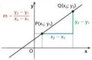

> **Esempio.** Il coefficiente angolare della retta passante per $A(-2; 2)$ e $B\left(3; -\frac{1}{2}\right)$ è:
>
> $$m = \frac{-\frac{1}{2} - 2}{3 - (-2)} = \frac{-\frac{5}{2}}{5} = -\frac{1}{2}.$$
>
> 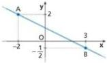

Se indichiamo con $\Delta x = x_2 - x_1$ l'incremento della $x$ e con $\Delta y = y_2 - y_1$ la corrispondente variazione della $y$, otteniamo:

$$m = \frac{y_2 - y_1}{x_2 - x_1} = \frac{\Delta y}{\Delta x}.$$

In particolare, se $\Delta x = 1$ allora $\Delta y = m$. Il coefficiente angolare è quindi il **tasso di variazione** della $y$ rispetto alla $x$: indica di quanto aumenta o diminuisce $y$ sulla retta per un aumento unitario di $x$. Quando l'ascissa aumenta di $1$, l'ordinata varia di $m$.

> **Esempio.**
>
> a. Nella retta $y = 2x - 1$ si ha $m = 2$: per andare da $A(1; 1)$ a $B(2; 3)$, quando $x$ aumenta di $1$, $y$ aumenta di $2$; lo stesso accade passando da $B$ a $C(3; 5)$.
>
> b. Nella retta $y = -3x + 1$ si ha $m = -3$: quando l'ascissa aumenta di $1$, l'ordinata diminuisce di $3$. Per andare da $A(-2; 7)$ a $B(1; -2)$, $x$ aumenta di $3$, quindi $y$ diminuisce di $9 = 3 \cdot 3$.
>
> | a. $y = 2x - 1$ | b. $y = -3x + 1$ |
> |:---:|:---:|
> | 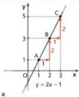 | 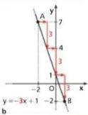 |

La formula ottenuta permette di calcolare il coefficiente angolare della retta passante per due punti, ma non la sua equazione: per ottenerla serve una condizione aggiuntiva, come il passaggio per uno dei due punti.

### 4.3 Retta passante per due punti

Vogliamo scrivere l'equazione della retta passante per $A(x_1; y_1)$ e $B(x_2; y_2)$, con $x_1 \neq x_2$ e $y_1 \neq y_2$. Il suo coefficiente angolare è $m = \dfrac{y_2 - y_1}{x_2 - x_1}$; scriviamo l'equazione della retta passante per $A$ con questo coefficiente angolare:

$$y - y_1 = \frac{y_2 - y_1}{x_2 - x_1}(x - x_1) \;\Rightarrow\; \boxed{\frac{y - y_1}{y_2 - y_1} = \frac{x - x_1}{x_2 - x_1}}$$

che è l'**equazione della retta per $A(x_1; y_1)$ e $B(x_2; y_2)$**, con $x_2 \neq x_1$ e $y_2 \neq y_1$.

> **Esempio.** Ricaviamo l'equazione della retta passante per $(-1; 2)$ e $(3; 1)$:
>
> $$\frac{y - 2}{1 - 2} = \frac{x - (-1)}{3 - (-1)} \;\Rightarrow\; \frac{y - 2}{-1} = \frac{x + 1}{4} \;\Rightarrow\; 4y - 8 = -x - 1 \;\Rightarrow\; y = -\frac{1}{4}x + \frac{7}{4}.$$

Se $x_1 = x_2$, la retta $AB$ è parallela all'asse $y$ e ha equazione $x = x_1$; se $y_1 = y_2$, è parallela all'asse $x$ e ha equazione $y = y_1$. In questi due casi scrivere l'equazione non richiede calcoli.

> **Esempio.**
>
> a. La retta passante per $A(-7; \sqrt{2})$ e $B(-7; 12)$ ha equazione $x = -7$.
>
> b. La retta passante per $A(2; 5)$ e $B(-8; 5)$ ha equazione $y = 5$.

## 5. Distanza di un punto da una retta

Tracciamo da un punto $P$ la perpendicolare a una retta $r$ e chiamiamo $H$ la **proiezione ortogonale** di $P$ su $r$, cioè il punto di intersezione fra $r$ e la perpendicolare. La misura del segmento $PH$ è la **distanza del punto $P$ dalla retta $r$**.

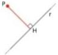

Consideriamo un punto $P(x_0; y_0)$ e una retta $r$. Esaminiamo i due casi possibili.

**La retta $r$ è parallela a un asse.** La distanza di $P$ da $r$ è il valore assoluto della differenza delle ordinate (o delle ascisse) di $P$ e $H$:

| $r: y = k$ | $r: x = h$ |
|:---:|:---:|
| $d = \lvert y_0 - k \rvert$ | $d = \lvert x_0 - h \rvert$ |
| 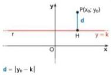 | 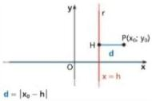 |

**La retta $r$ non è parallela agli assi.** In questo caso consideriamo la distanza come altezza di un opportuno triangolo rettangolo.

> **Esempio.** Dato il punto $P(3; 1)$, calcoliamo la sua distanza dalla retta $4x - 3y + 3 = 0$.
>
> Tracciamo da $P$ le parallele agli assi fino a incontrare la retta nei punti $A$ e $B$. Otteniamo il triangolo rettangolo $APB$, di cui $PH$ è l'altezza relativa all'ipotenusa.
>
> $A$ ha la stessa ordinata di $P$; sostituendo $y = 1$ nell'equazione della retta: $4x - 3 \cdot 1 + 3 = 0 \Rightarrow x = 0$. In modo analogo, poiché $B$ ha la stessa ascissa di $P$, si ricava che la sua ordinata è $5$. Quindi $A(0; 1)$ e $B(3; 5)$.
>
> Il doppio dell'area di $APB$ è il prodotto dei cateti $AP$ e $PB$; dividendo per l'ipotenusa $AB$ otteniamo l'altezza $PH$:
>
> $$\overline{PH} = \frac{\overline{PA} \cdot \overline{PB}}{\overline{AB}} = \frac{3 \cdot 4}{5} = \frac{12}{5}.$$
>
> 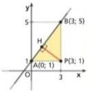

Con lo stesso procedimento si dimostra che, in generale, la distanza $d$ di un punto $P(x_0; y_0)$ dalla retta $ax + by + c = 0$ è:

$$\boxed{d = \frac{|ax_0 + by_0 + c|}{\sqrt{a^2 + b^2}}}$$

> **Esempio.** Ricalcoliamo la distanza dell'esempio precedente con la formula, con $P(3; 1)$ e la retta $4x - 3y + 3 = 0$:
>
> $$d = \frac{|4 \cdot 3 - 3 \cdot 1 + 3|}{\sqrt{4^2 + 3^2}} = \frac{|12 - 3 + 3|}{\sqrt{25}} = \frac{12}{5}.$$

## 6. Luoghi geometrici e retta

Un **luogo geometrico** è l'insieme di tutti e soli i punti che godono di una proprietà, detta **proprietà caratteristica** del luogo.

Per studiare un luogo geometrico nel piano cartesiano si cerca un'equazione in due incognite $f(x; y) = 0$ le cui soluzioni sono le coordinate di tutti e soli i punti del luogo:

$$P(x_0; y_0) \text{ appartiene al luogo} \quad \Longleftrightarrow \quad f(x_0; y_0) = 0.$$

L'equazione $f(x; y) = 0$ è detta **equazione del luogo**. Una retta può essere vista come il luogo dei punti che godono della proprietà di allineamento; come sappiamo, l'equazione di questo luogo è un'equazione lineare.

### 6.1 Asse di un segmento

L'**asse di un segmento** è la retta perpendicolare al segmento passante per il suo punto medio. La sua equazione si può ricavare ricordando che l'asse è il luogo dei punti equidistanti dagli estremi del segmento.

> **Esempio.** Ricaviamo l'equazione dell'asse del segmento di estremi $A(-1; 5)$ e $B(3; 1)$, cioè il luogo dei punti $P(x; y)$ tali che $\overline{PA} = \overline{PB}$:
>
> $$\sqrt{(x + 1)^2 + (y - 5)^2} = \sqrt{(x - 3)^2 + (y - 1)^2}.$$
>
> Poiché entrambi i membri sono non negativi, eleviamo al quadrato e svolgiamo i calcoli:
>
> $$x^2 + 2x + 1 + y^2 - 10y + 25 = x^2 - 6x + 9 + y^2 - 2y + 1 \;\Rightarrow\; y = x + 2.$$
>
> 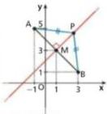

### 6.2 Bisettrici degli angoli formati da due rette

La **bisettrice** di un angolo lo divide in due angoli congruenti ed è il luogo dei punti equidistanti dai lati dell'angolo.

Consideriamo due rette $r$ e $s$, non parallele tra loro:

$$r: ax + by + c = 0, \qquad s: a'x + b'y + c' = 0.$$

Un generico punto $P(x; y)$ appartiene a una delle due bisettrici se e solo se ha la stessa distanza da $r$ e da $s$. Usando la formula della distanza di un punto da una retta:

$$\frac{|ax + by + c|}{\sqrt{a^2 + b^2}} = \frac{|a'x + b'y + c'|}{\sqrt{a'^2 + b'^2}} \quad \Longrightarrow \quad \boxed{\frac{ax + by + c}{\sqrt{a^2 + b^2}} = \pm\,\frac{a'x + b'y + c'}{\sqrt{a'^2 + b'^2}}}$$

Svolgendo i calcoli si ottengono le equazioni delle due bisettrici.

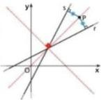

> **Esempio.** Troviamo le bisettrici degli angoli formati dalle rette
>
> $$r: 4x + 3y - 1 = 0, \qquad s: 3x + 4y + 1 = 0.$$
>
> Un punto $P(x; y)$ di una bisettrice ha la stessa distanza da $r$ e da $s$, cioè $\overline{PH} = \overline{PK}$:
>
> $$\frac{|4x + 3y - 1|}{5} = \frac{|3x + 4y + 1|}{5} \;\Rightarrow\; |4x + 3y - 1| = |3x + 4y + 1|.$$
>
> Le soluzioni di questa equazione sono quelle delle due equazioni $4x + 3y - 1 = \pm(3x + 4y + 1)$:
>
> $$4x + 3y - 1 = -(3x + 4y + 1) \;\lor\; 4x + 3y - 1 = 3x + 4y + 1 \;\Rightarrow\; x + y = 0 \;\lor\; x - y - 2 = 0.$$
>
> Le bisettrici hanno quindi equazioni $x + y = 0$ e $x - y - 2 = 0$.
>
> 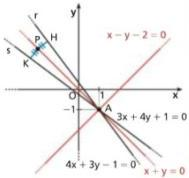

## 7. Fasci di rette

### 7.1 Fascio improprio

Data una retta $r$ del piano, l'insieme formato da $r$ e da tutte le rette a essa parallele si chiama **fascio improprio** di rette parallele a $r$.

Se $r$, non parallela all'asse $y$, ha equazione $y = mx + q$, le rette del fascio hanno tutte lo stesso coefficiente angolare $m$, mentre $q$ varia da retta a retta. Se $r$ è parallela all'asse $y$, il fascio ha equazione $x = k$.

> **Esempio.** Troviamo l'equazione del fascio improprio di cui fa parte la retta $r$ che interseca gli assi in $(0; 3)$ e $(1; 0)$.
>
> L'intersezione con l'asse $y$ è $(0; 3)$, quindi l'ordinata all'origine è $3$. Passando dal punto di ascissa $0$ a quello di ascissa $1$, l'ordinata diminuisce di $3$, quindi il coefficiente angolare è $-3$. La retta $r$ ha equazione $y = -3x + 3$ e il fascio improprio ha equazione
>
> $$y = -3x + q.$$
>
> Al variare di $q$ (l'ordinata all'origine) si ottengono tutte le rette del fascio.
>
> 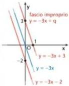

### 7.2 Fascio proprio

L'insieme di tutte le rette del piano che passano per uno stesso punto $P$ si chiama **fascio proprio** di rette per $P$. Il punto $P$ comune a tutte le rette del fascio è il **centro** del fascio.

> **Esempio.** Determiniamo l'equazione del fascio proprio di centro $P(2; 4)$.
>
> L'equazione della retta di coefficiente angolare $m$ passante per $(x_1; y_1)$ è $y - y_1 = m(x - x_1)$; con centro $P(2; 4)$ otteniamo:
>
> $$y - 4 = m(x - 2).$$
>
> Al variare di $m$ otteniamo le rette del fascio:
>
> - per $m = 1$: $y - 4 = x - 2$, cioè $y = x + 2$;
> - per $m = -2$: $y - 4 = -2x + 4$, cioè $y = -2x + 8$;
> - per $m = 0$: la parallela all'asse $x$, $y = 4$; e così via.
>
> La parallela all'asse $y$ passante per $P$ ha equazione $x = 2$, ma non esiste alcun valore di $m$ che la fornisca. Pertanto il fascio è descritto da:
>
> $$y - 4 = m(x - 2) \;\lor\; x = 2, \qquad m \in \mathbb{R}.$$
>
> 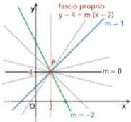

In generale, con l'equazione $y - y_1 = m(x - x_1)$, al variare di $m$ si ottengono tutte le rette passanti per $P(x_1; y_1)$ tranne la parallela all'asse $y$, di equazione $x = x_1$. Quindi il fascio di rette di centro $(x_1; y_1)$ è descritto da:

$$\boxed{y - y_1 = m(x - x_1) \;\lor\; x = x_1, \qquad m \in \mathbb{R}}$$

Talvolta, per brevità, si omette la retta $x = x_1$; quando viene inclusa esplicitamente si parla di **equazione completa del fascio**.

### 7.3 Fasci generati da due rette

Un fascio di rette può essere generato anche a partire da due rette $r$ e $s$ di cui si conoscono le equazioni: se $r$ e $s$ sono incidenti si ottiene un fascio proprio, se sono parallele un fascio improprio. Il fascio si scrive usando la **combinazione lineare** delle equazioni delle due rette.

#### Combinazione lineare di due equazioni

Date due equazioni $A(x; y) = 0$ e $B(x; y) = 0$, si chiama **combinazione lineare** delle due equazioni ogni equazione del tipo

$$p \cdot A(x; y) + q \cdot B(x; y) = 0, \qquad \text{con } p, q \in \mathbb{R} \text{ non entrambi nulli}.$$

I numeri $p$ e $q$ sono detti **parametri** della combinazione lineare.

> **Esempio.** Una combinazione lineare delle equazioni $3x - 5y - 4 = 0$ e $x - 2y + 1 = 0$ è:
>
> $$p\,(3x - 5y - 4) + q\,(x - 2y + 1) = 0, \qquad p, q \in \mathbb{R} \text{ non entrambi nulli}.$$

Se la coppia $(c; d)$ è soluzione di entrambe le equazioni, allora è soluzione anche di ogni loro combinazione lineare. Infatti, per ogni $p$ e $q$:

$$A(c; d) = 0, \quad B(c; d) = 0 \;\Rightarrow\; p \cdot A(c; d) + q \cdot B(c; d) = p \cdot 0 + q \cdot 0 = 0.$$

#### Fascio proprio generato da due rette

Date due rette $r: ax + by + c = 0$ e $s: a'x + b'y + c' = 0$ che si incontrano nel punto $C(x_1; y_1)$, si può dimostrare che tutte le rette del fascio proprio di centro $C$ si ottengono dalla combinazione lineare

$$p\,(ax + by + c) + q\,(a'x + b'y + c') = 0, \qquad p, q \in \mathbb{R} \text{ non entrambi nulli}.$$

Le rette $r$ e $s$ sono dette **generatrici** del fascio; le loro equazioni si ottengono rispettivamente per $q = 0$ e per $p = 0$.

Supposto $p \neq 0$, dividiamo entrambi i membri per $p$ e poniamo $k = \dfrac{q}{p}$:

$$\boxed{ax + by + c + k\,(a'x + b'y + c') = 0, \qquad k \in \mathbb{R}}$$

A ogni valore di $k$ corrisponde una retta del fascio; in particolare, per $k = 0$ si ottiene $r$. Non vale però il viceversa: la retta $s$ non corrisponde ad alcun valore di $k$, ed è l'unica retta esclusa.

> **Esempio.** Studiamo il fascio generato dalle rette
>
> $$r: 2x - y - 1 = 0, \qquad s: x + y - 5 = 0.$$
>
> Combinandole linearmente con un solo parametro reale $k$ otteniamo:
>
> $$2x - y - 1 + k\,(x + y - 5) = 0.$$
>
> Al variare di $k$, questa equazione rappresenta le infinite rette passanti per il punto $C$ di intersezione delle due rette, esclusa $s$: è il fascio proprio di centro $C$. Per esempio, per $k = 2$ si ottiene $t: 4x + y - 11 = 0$, per $k = -2$ si ottiene $u: y = 3$. La retta $r$ si ottiene per $k = 0$, mentre $s$ è l'unica che non si ottiene.
>
> 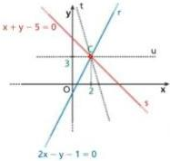
>
> Tuttavia, dividendo l'equazione per $k$ si ottiene
>
> $$\frac{1}{k}\,(2x - y - 1) + (x + y - 5) = 0.$$
>
> Se a $k$ sostituiamo valori sempre maggiori, cioè per $k \to +\infty$ (si legge «$k$ tendente a più infinito»), $\frac{1}{k}$ tende a $0$ e otteniamo l'equazione di $s$: $x + y - 5 = 0$. Analogamente per $k \to -\infty$. Diciamo allora che la retta $s$ si ottiene dall'equazione del fascio per $k \to \pm\infty$.

Le generatrici del fascio possono essere due rette qualsiasi del fascio. In particolare, se consideriamo le due rette parallele agli assi passanti per $P_1(x_1; y_1)$, di equazioni $x - x_1 = 0$ e $y - y_1 = 0$, otteniamo

$$p\,(x - x_1) + q\,(y - y_1) = 0,$$

da cui, con $q \neq 0$ e posto $m = -\dfrac{p}{q}$:

$$y - y_1 = m\,(x - x_1),$$

cioè l'equazione della retta passante per un punto e di coefficiente angolare $m$, già ricavata in altro modo.

#### Fascio improprio generato da due rette

Si può dimostrare che anche l'equazione di un fascio improprio si ottiene dalla combinazione lineare delle equazioni di due rette del fascio.

> **Esempio.** Studiamo il fascio generato dalle rette parallele
>
> $$a: x - y + 1 = 0, \qquad b: x - y - 3 = 0.$$
>
> Combinandole linearmente con un parametro reale $k$:
>
> $$x - y + 1 + k\,(x - y - 3) = 0.$$
>
> Esplicitiamo la $y$:
>
> $$x - y + 1 + kx - ky - 3k = 0 \;\Rightarrow\; (k + 1)\,y = (k + 1)\,x + 1 - 3k \;\xrightarrow{\;k \neq -1\;}\; y = x + \frac{1 - 3k}{k + 1}.$$
>
> Al variare di $k$ (con $k \neq -1$) si ottiene una retta parallela alle generatrici: l'equazione rappresenta un fascio improprio.
>
> 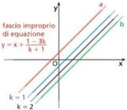

#### Caso generale

Date due rette distinte

$$r: ax + by + c = 0, \qquad s: a'x + b'y + c' = 0,$$

il fascio di rette da esse generato ha equazione

$$ax + by + c + k\,(a'x + b'y + c') = 0 \quad \Longleftrightarrow \quad (a + ka')\,x + (b + kb')\,y + c + kc' = 0.$$

Il fascio è:

- **proprio** se $\dfrac{a}{b} \neq \dfrac{a'}{b'}$;
- **improprio** se $\dfrac{a}{b} = \dfrac{a'}{b'}$.

In entrambi i casi l'equazione rappresenta tutte le rette del fascio tranne la retta $s$.

Un'equazione lineare in $x$ e $y$ con coefficienti che dipendono (linearmente) da un parametro $k$ rappresenta un fascio di rette, di cui solitamente occorre studiare le caratteristiche.

#### Famiglie di rette

Se nell'equazione parametrica il parametro $k$ compare con grado maggiore di $1$, non si ha un fascio di rette ma una più generica **famiglia di rette**, che possono essere fra loro parallele o incidenti. Per esempio, nell'equazione

$$(k^2 - 1)\,x + ky + 2 = 0$$

si ha:

- per $k = 1$: $y + 2 = 0 \;\Rightarrow\; y = -2$;
- per $k = -1$: $-y + 2 = 0 \;\Rightarrow\; y = 2$;
- per $k = 0$: $-x + 2 = 0 \;\Rightarrow\; x = 2$.

Le prime due rette sono parallele, mentre la terza è incidente a ciascuna delle altre due.

## Riepilogo

**Segmenti.** Dati $P_1(x_1; y_1)$ e $P_2(x_2; y_2)$:

- punto medio: $M\left(\dfrac{x_1 + x_2}{2}; \dfrac{y_1 + y_2}{2}\right)$;
- distanza: $\overline{P_1P_2} = \sqrt{(x_2 - x_1)^2 + (y_2 - y_1)^2}$.

**Baricentro** del triangolo di vertici $A$, $B$, $C$: $G\left(\dfrac{x_A + x_B + x_C}{3}; \dfrac{y_A + y_B + y_C}{3}\right)$.

**Equazione di una retta:**

- forma implicita: $ax + by + c = 0$;
- forma esplicita: $y = mx + q$ (retta non parallela all'asse $y$), con $m$ coefficiente angolare e $q$ ordinata all'origine;
- parallela all'asse $x$: $y = k$; parallela all'asse $y$: $x = h$;
- passante per l'origine: $y = mx$;
- per un punto $P(x_1; y_1)$ con coefficiente angolare $m$: $y - y_1 = m(x - x_1)$;
- per due punti: $\dfrac{y - y_1}{y_2 - y_1} = \dfrac{x - x_1}{x_2 - x_1}$, con coefficiente angolare $m = \dfrac{y_2 - y_1}{x_2 - x_1}$.

**Angolo con l'asse $x$:** acuto se $m > 0$, ottuso se $m < 0$; se $m = 0$ la retta è parallela all'asse $x$; il coefficiente angolare non esiste se la retta è parallela all'asse $y$.

**Posizione reciproca** di $r: ax + by + c = 0$ e $s: a_1x + b_1y + c_1 = 0$:

- $r \parallel s \;\Longleftrightarrow\; m = m_1 \;\Longleftrightarrow\; ab_1 - a_1b = 0$;
- $r \perp s \;\Longleftrightarrow\; m \cdot m_1 = -1 \;\Longleftrightarrow\; aa_1 + bb_1 = 0$.

**Distanza** di $P(x_0; y_0)$ dalla retta $ax + by + c = 0$:

$$d = \frac{|ax_0 + by_0 + c|}{\sqrt{a^2 + b^2}}.$$

**Luoghi geometrici:**

- asse di un segmento: retta perpendicolare al segmento nel suo punto medio; luogo dei punti equidistanti dagli estremi;
- bisettrice di un angolo: luogo dei punti equidistanti dai lati; le bisettrici degli angoli formati da due rette incidenti sono
  $$\frac{ax + by + c}{\sqrt{a^2 + b^2}} = \pm\,\frac{a'x + b'y + c'}{\sqrt{a'^2 + b'^2}}.$$

**Fasci di rette:**

- improprio: $y = mx + q$ con $m$ fissato e $q$ variabile (oppure $x = k$);
- proprio di centro $(x_1; y_1)$: $y - y_1 = m(x - x_1) \;\lor\; x = x_1$;
- generato da $r$ e $r'$: $ax + by + c + k\,(a'x + b'y + c') = 0$; proprio se $r$ e $r'$ sono incidenti (centro nel loro punto di intersezione), improprio se sono parallele.
